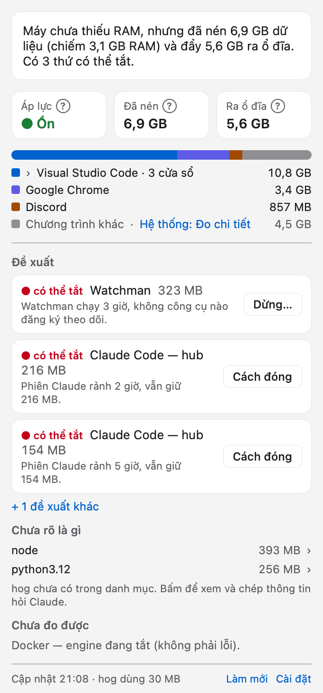

# hog

> **What is eating your Mac, who owns it, and is it safe to stop?** — a menu bar app and CLI for developers.

Activity Monitor shows many columns (Memory, Real Mem, Compressed, Cached Files, Wired, Swap…) but not *which of them
matters* or *what you can close*. Most of the memory on a developer machine is held by things that open no port and
have unhelpful names: language servers inside VS Code windows, a `watchman` nobody uses any more, Claude Code sessions
idle for hours, a container restarting in a loop.

hog answers four questions, in this order:

1. **Is the machine short of memory?** — one sentence, based on memory pressure, compression and swap.
2. **What is eating it, and who owns it?** — grouped by app → VS Code window → Claude session / project.
3. **Can I stop it, and what do I lose?** — suggestions backed by measurements, never guesses.
4. **What does this number mean?** — every number has a plain-language explanation, with the Activity Monitor name.



hog started as `lps` (list processes by listening port); `hog ports` keeps that view.

## Install (from source)

Requires macOS 14+ on Apple Silicon and Swift 6 (Xcode or the command line tools).

```bash
git clone https://github.com/linhh-phv/hog.git
cd hog
scripts/install.sh        # Hog.app in your user Applications folder + ~/.local/bin/hog
open -a Hog               # start the menu bar app
```

`scripts/build-app.sh` only builds `dist/Hog.app` (ad-hoc signed) without installing anything.

## Use

```bash
hog                          # headline, memory/CPU, biggest consumers, suggestions
hog --json                   # snapshot (compact; --pretty to read, --brief for Claude, --full for everything)
                             # --fast skips VS Code/watchman and the current CPU sample
hog explain <item|pid|port>  # every measurement, which rules fired and why, what the safety gates say
hog explain <term>           # what a number means (hog explain terms)
hog explain system           # measure macOS/system processes once with top (~2 s)
hog ports | hog orphans      # listening ports grouped by project (the old lps view)
hog stop <item|pid|port|container>
hog stop --yes --plan <id>   # run a plan a person agreed to (valid 10 minutes)
hog catalog list|show|check · hog rules list|check · hog version · hog help
```

Language follows the system (Vietnamese or English); set `HOG_LANG=vi|en` or `--lang` to choose.
Commands hog calls are looked up by absolute path (apps get no shell `PATH`); add your own in
`~/.config/hog/config.json`: `{"commands": {"code": ["/path/to/code"]}}`.

The first time the app looks at processes in Desktop, Documents or Downloads, macOS asks for access: hog reads
`package.json` / `.git` there to name the project. Nothing is changed or sent anywhere.
Exit codes: `0` done · `1` error · `2` usage · `3` needs a person's agreement · `4` blocked by a safety gate.

## Safety

Stopping always goes through the same gates, in the CLI, in the app and for Claude:

- never hog itself or anything running it; never processes of other users or macOS itself; never `sudo`;
- something owned by another window or Claude session needs a confirmation that names the owner;
- the process identity (PID + start time) is re-read right before signalling — a reused PID is never hit;
- SIGTERM first; hog **never** escalates to SIGKILL on its own — that is a new plan and a new "yes";
- containers with a restart policy get it set to `no` (and read back) before they are stopped;
- stopping never deletes anything; every stop is logged to `~/.local/state/hog/actions.jsonl`;
- "unused" is only said when it was measured (connections, age, CPU, how much is still in RAM…).

Sensors are read-only and never start anything (no Docker CLI, `watchman --no-spawn`, sockets checked first). One
exception: when `code --status` hangs, hog removes the `Code --status` processes and temp files that call itself
left behind, and stops asking until VS Code restarts (`~/.local/state/hog/vscode-status-timeout`).
hog sends nothing over the network.

## Data, not code

What hog knows lives in JSON files, one per entry, in Vietnamese and English:

- `Sources/HogCore/Resources/catalog/` — what a process is and what stopping it does;
- `Sources/HogCore/Resources/rules/` — when to suggest, watch or protect (three-valued logic: a missing measurement never
  supports a stop);
- `Sources/HogCore/Resources/explain/` — the glossary and the one-line headlines.

Local additions go to `~/.config/hog/catalog.d/` and `~/.config/hog/rules.d/` (same id overrides; hard protections
cannot be overridden). Data files cannot contain commands. Check them with `hog catalog check` / `hog rules check`.

## Develop

```bash
swift build
swift test
swift run hog
swift run HogBar --render /tmp/hog-render --sample   # PNGs of the menu, light and dark
```

Design (Vietnamese): [docs/architecture/design-vi.md](docs/architecture/design-vi.md) ·
UI: [docs/design/design-system.md](docs/design/design-system.md) · conventions: [CLAUDE.md](CLAUDE.md).

## License

MIT — see [LICENSE](LICENSE).
